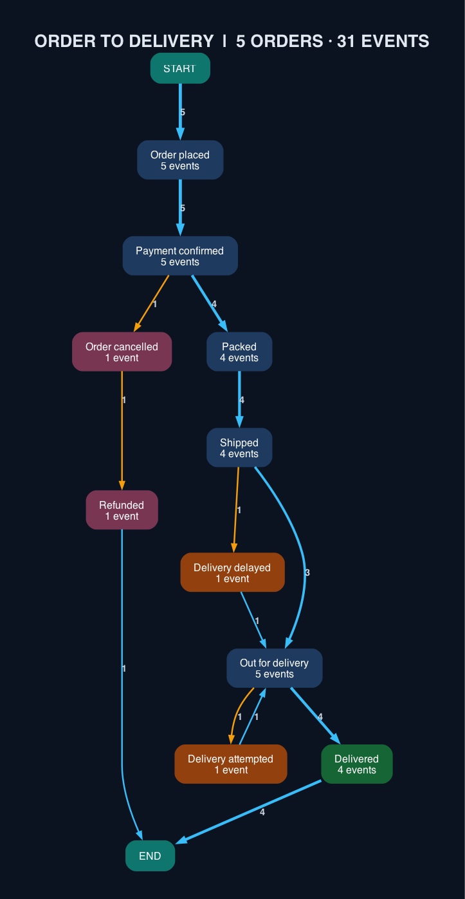

# Tiny process mining example

This project demonstrates a simple process mining example using a **synthetic** online order and parcel delivery event log with [PM4Py](https://processintelligence.solutions/pm4py/).

## Run

From the project directory:

```bash
python3 -m venv .venv
source .venv/bin/activate
python -m pip install -r requirements.txt
python load_events.py
```

The script reads `data/sample_orders.csv` and prints the number of events, orders, and activities, followed by a preview of the event log.

## Process graph

Graph generation also needs the Graphviz `dot` executable (`brew install graphviz` on macOS).

```bash
python make_graph.py
```

This creates `charts/process_graph.svg` and `charts/process_graph.png`. Boxes show activities and their event counts. Arrows show how often one activity directly followed another within an order. Orange arrows lead into delay, failed delivery attempt, cancellation, and refund activities.


